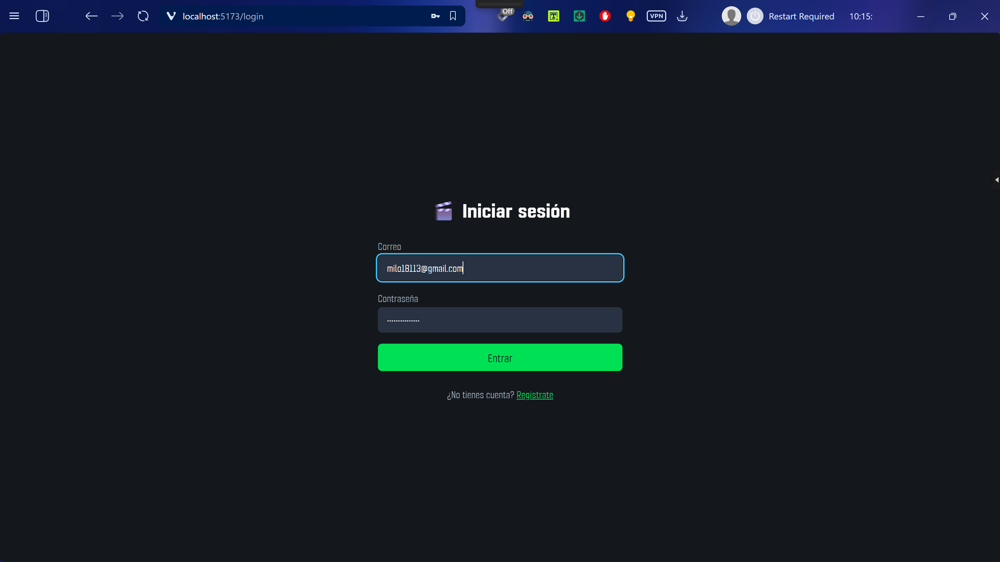
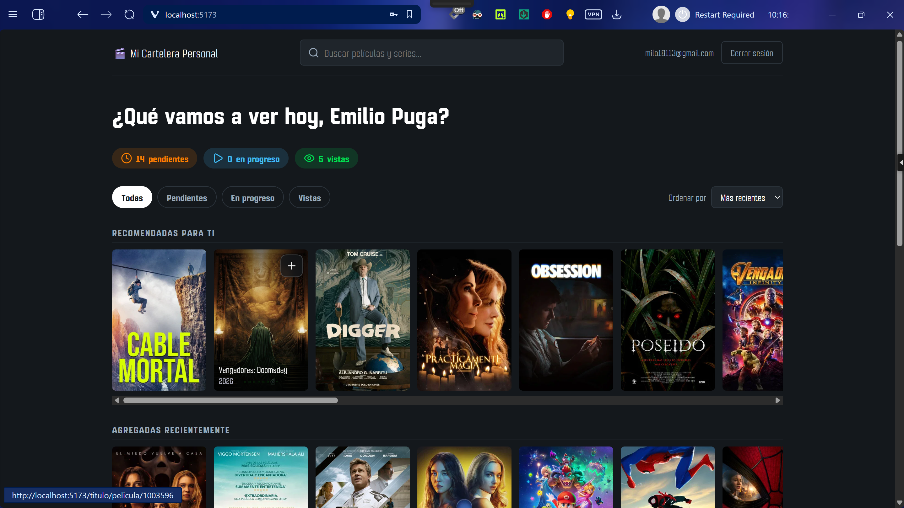
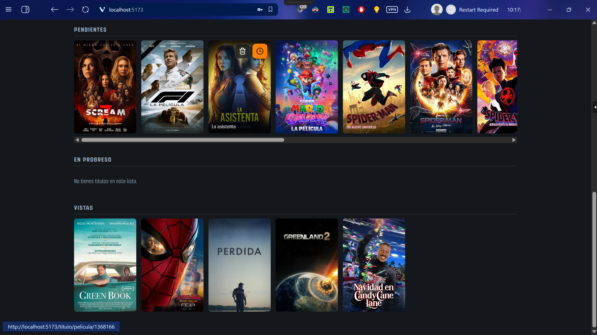
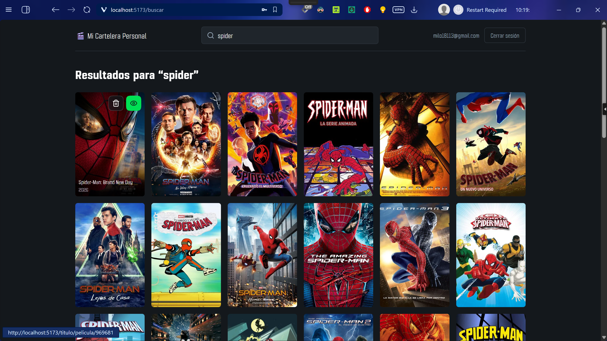
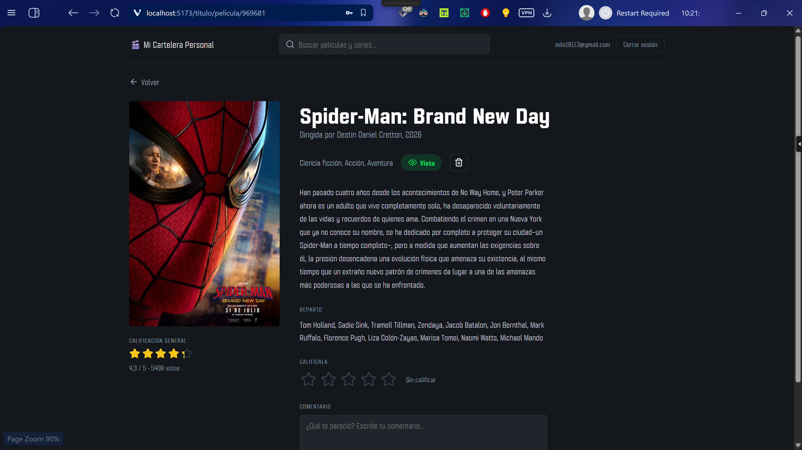
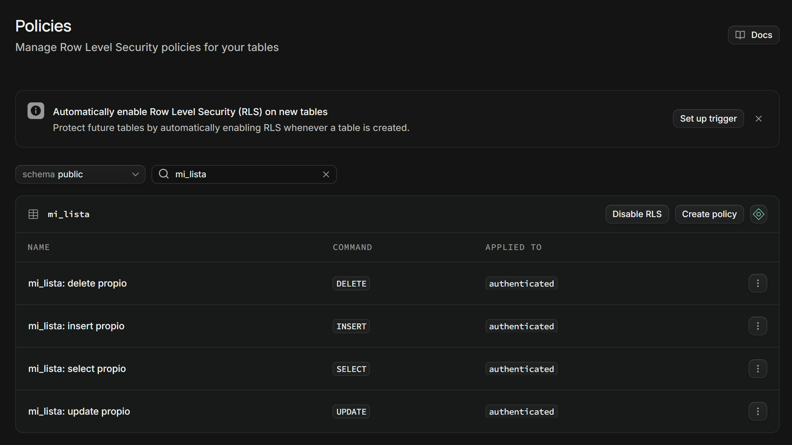

# 🎬 Mi Cartelera Personal

Aplicación web donde cada usuario registra, organiza y califica las películas y series que quiere ver, está viendo o ya vio. Busca títulos reales en la API de [The Movie Database (TMDB)](https://www.themoviedb.org/) (póster, sinopsis, reparto, calificación oficial) y guarda su propia versión —estado, calificación y comentario personal— en una base de datos PostgreSQL de Supabase, protegida por autenticación y Row Level Security.

Proyecto de la materia Desarrollo Web 2 (USFQ), Enregable 3.

<!-- Si se publica la app, pegar aquí el enlace. -->
**Demo en vivo:** _(pendiente)_

## Tecnologías

| Capa | Tecnología | Uso |
|---|---|---|
| Frontend | React 19 + TypeScript (Vite) | Componentes funcionales con hooks, props e interfaces tipadas |
| Routing | React Router | Rutas protegidas, búsqueda y detalle como URLs compartibles |
| API externa | TMDB | Búsqueda, recomendaciones, detalle y reparto |
| Autenticación | Supabase Auth | Registro, login, logout y sesión persistente |
| Base de datos | Supabase (PostgreSQL) | Tabla `mi_lista` con políticas RLS por usuario |
| Estilos | CSS plano (una sola hoja) | `src/index.css` |

## Funcionalidades

- **Acceso controlado:** ninguna pantalla de contenido es visible sin sesión; el logout está siempre visible en el header.
- **Búsqueda en TMDB:** al presionar Enter se muestra una grilla de películas y series, con estados de carga y error. El año escrito se usa como pista (`matrix 1999`) sin esconder títulos que lleven números (`Blade Runner 2049`).
- **Mi lista:** agregar, cambiar de estado (`por ver` → `viendo` → `vista`) y eliminar desde cualquier tarjeta.
- **Calificación y comentario personales** (1 a 5 y texto libre), independientes de la nota de TMDB.
- **Página de detalle:** póster grande, sinopsis, director o creador, géneros, reparto, nota general de TMDB con estrellas y tu calificación y comentario.
- **Resumen y filtros:** contador de pendientes, en progreso y vistas; filtro por estado y orden por fecha o calificación.
- **Recomendaciones:** fila de películas populares de TMDB elegidas al azar, sin los títulos que ya guardaste.
- **Seguridad real (RLS):** cada usuario solo ve, edita y borra sus propias filas, verificado contra la base de datos.

## Capturas

### Login y registro



### Inicio

Se muestran las tarjetas de películas solamente con su poster por defecto. Se muestra la información adicional (título, año, estado) al hacer hover con el mouse sobre la tarjeta.





### Búsqueda



### Detalle de un título



## Instalación

### Requisitos previos

- Node.js 20.19 o superior (recomendado 22 LTS)
- Una cuenta gratuita en [Supabase](https://supabase.com/)
- Una API key gratuita de [TMDB](https://www.themoviedb.org/settings/api)

### 1. Clonar e instalar dependencias

```bash
git clone <url-del-repositorio>
cd cartelera-personal
npm install
```

### 2. Configurar Supabase

1. Crea un proyecto en Supabase.
2. En **SQL Editor**, pega y ejecuta [`docs/schema.sql`](docs/schema.sql). Crea la tabla `mi_lista`, activa RLS y define las 4 políticas.
3. En **Authentication → Sign In / Providers → Email**, desactiva **Confirm email** para desarrollar y probar (con la confirmación activa, el registro no inicia sesión hasta confirmar el correo).
4. En **Authentication → URL Configuration**, pon `http://localhost:5173` como Site URL.

### 3. Variables de entorno

Copia el archivo de ejemplo y completa los valores:

```bash
cp .env.example .env
```

| Variable | Dónde obtenerla |
|---|---|
| `VITE_SUPABASE_URL` | Supabase → Project Settings → API → **Project URL**. Con la forma `https://xxxx.supabase.co`, **sin** `/rest/v1/` al final. |
| `VITE_SUPABASE_ANON_KEY` | Supabase → Project Settings → API Keys → **Publishable key** (`sb_publishable_…`) o la clave `anon` legacy. |
| `VITE_TMDB_API_KEY` | TMDB → Settings → API → **API Key (v3)**, la de 32 caracteres. |

> **Nunca** uses la clave `service_role` / `secret` en el frontend: salta RLS. El archivo `.env` está en `.gitignore`; solo `.env.example` (sin valores) se versiona. La clave publishable/anon es pública por diseño y la protege RLS.

## Cómo correr

```bash
npm run dev       # servidor de desarrollo en http://localhost:5173
npm run build     # typecheck + build de producción en dist/
npm run preview   # sirve el build localmente
npm run lint      # ESLint
```

Reinicia `npm run dev` si cambias el `.env`: Vite solo lo lee al arrancar.

## Estructura del proyecto

La estructura sigue una separación por capas: el dominio es puro y la infraestructura (Supabase, TMDB) queda en los bordes.

```
src/
├── domain/             # tipos y reglas puras, sin React ni red
│   ├── miLista.ts      #   Estado, ItemLista, siguienteEstado(), ordenarLista()
│   ├── busqueda.ts     #   interpretarBusqueda(): el año es una pista, no un filtro
│   └── detalle.ts      #   DetalleTitulo
├── infrastructure/     # acceso a servicios externos
│   ├── miListaRepository.ts  # CRUD sobre Supabase (mi_lista)
│   └── tmdb.ts               # búsqueda, recomendaciones y detalle en TMDB
├── lib/                # cliente de Supabase y helpers de rutas
├── auth/               # AuthProvider (Context), useAuth, ProtectedRoute
├── lista/              # MiListaProvider (Context): una sola copia de la lista
├── hooks/              # useBusqueda, useDetalleTitulo, useRecomendaciones, useAccionesTarjeta
├── components/         # tarjetas, filas, pills, estrellas, buscador, formularios
├── pages/              # Login, Registro, Inicio, Búsqueda, Detalle
└── index.css           # única hoja de estilos
docs/
└── schema.sql          # tabla mi_lista + RLS
scripts/
└── test-rls.ts         # prueba de RLS contra la API REST
```

## Modelo de datos

Una sola tabla propia, `mi_lista`, relacionada con `auth.users` (que Supabase ya mantiene):

| Columna | Tipo | Descripción |
|---|---|---|
| `id` | bigint (identity, PK) | Identificador de la fila |
| `user_id` | uuid (FK → `auth.users.id`) | Dueño del registro; es la columna que usa RLS. Default `auth.uid()` |
| `tmdb_id` | integer | ID del título en TMDB |
| `titulo` | text | Título tal como aparece en TMDB |
| `poster_url` | text | URL del póster |
| `tipo_contenido` | text (`pelicula` \| `serie`) | Distingue películas de series |
| `estado` | text (`por_ver` \| `viendo` \| `vista`) | Estado de visualización |
| `calificacion_personal` | integer (1 a 5, nullable) | Calificación del usuario |
| `comentario` | text (nullable) | Comentario libre |
| `fecha_agregado` | timestamptz (default `now()`) | Para ordenar |

Hay una restricción `unique (user_id, tmdb_id, tipo_contenido)`: no se puede guardar dos veces el mismo título. El tipo forma parte de la clave porque TMDB reutiliza IDs entre películas y series.

## Seguridad (RLS)

`mi_lista` tiene Row Level Security activado y una política por operación (`select`, `insert`, `update`, `delete`), todas para `authenticated` y con la condición `auth.uid() = user_id`. Una política de `update` incluye además `with check` para impedir reasignar una fila a otro usuario.



### Verificación

El script [`scripts/test-rls.ts`](scripts/test-rls.ts) comprueba que la protección vive en la base de datos y no solo en el frontend. Habla directo con la API REST (sin pasar por la interfaz) y usa el token de dos usuarios de prueba que crea al vuelo. Verifica que:

- sin sesión no se ve ni se inserta nada;
- cada usuario ve únicamente sus propias filas, incluso pidiendo por `id` la fila de otro;
- un usuario no puede editar ni borrar la fila de otro, y la fila ajena queda intacta;
- no se puede insertar una fila a nombre de otro usuario ni reasignar una propia;
- cada dueño sí puede editar lo suyo (descarta que todo falle por mala configuración).

Requiere **Confirm email** desactivado y el `.env` configurado. Desde la raíz del proyecto:

```bash
node --experimental-strip-types scripts/test-rls.ts
```

Resultado de la última ejecución:

```text
USFQ+00336640@Emilio-Puga MINGW64 ~/OneDrive - Universidad San Francisco de Quito/Documentos/USFQ/7mo Semestre/Desarrollo Web 2/cartelera-personal (master)
$ node --experimental-strip-types scripts/test-rls.ts
(node:29764) ExperimentalWarning: Type Stripping is an experimental feature
 and might change at any time
(Use `node --trace-warnings ...` to show where the warning was created)    
Usuario A: rls-test-a-1792032537398@example.com
Usuario B: rls-test-b-1792032538194@example.com

PASS  A inserta su propia fila
        HTTP 201
PASS  B inserta su propia fila
        HTTP 201
PASS  Sin sesión no se ve ninguna fila
        HTTP 200, 0 filas
PASS  B solo ve sus propias filas
        1 fila(s) visibles para B
PASS  B no puede leer la fila de A pidiéndola por id
        0 filas devueltas
PASS  B no puede editar la fila de A
        0 filas afectadas
PASS  B no puede borrar la fila de A
        0 filas afectadas
PASS  La fila de A sigue intacta (existe y su comentario no cambió)        
        comentario actual: "original de A"
PASS  B no puede insertar una fila a nombre de A
        HTTP 403: new row violates row-level security policy for table "mi_
lista"
PASS  B no puede reasignar su propia fila a A
        HTTP 403: new row violates row-level security policy for table "mi_
lista"
PASS  Sin sesión no se puede insertar
        HTTP 401: new row violates row-level security policy for table "mi_
lista"
PASS  A sí puede editar su propia fila
        HTTP 200

12/12 verificaciones correctas.
```

Al terminar, el script borra sus propias filas. Los usuarios de prueba quedan en `auth.users`; para eliminarlos, en el SQL Editor:

```sql
delete from auth.users where email like 'rls-test-%@example.com';
```

## Créditos

Los datos de películas y series provienen de la API de TMDB. This product uses the TMDB API but is not endorsed or certified by TMDB.
