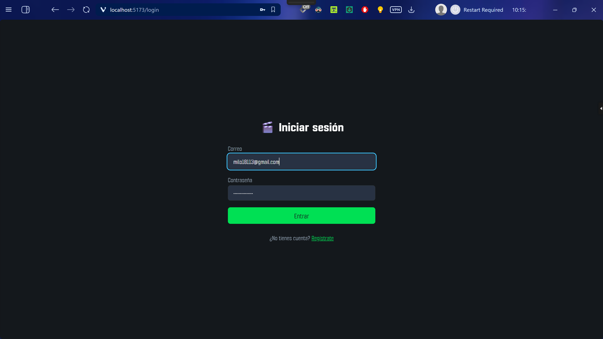
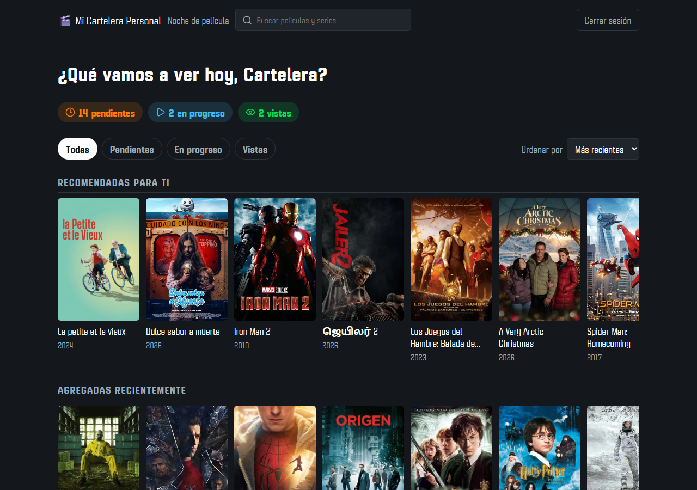
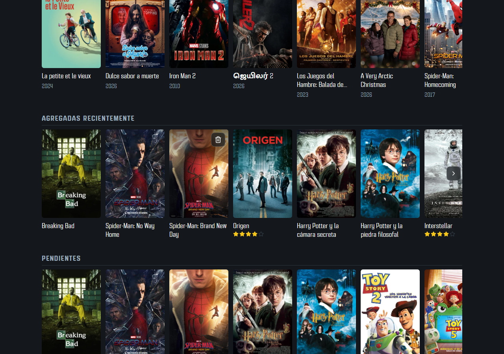
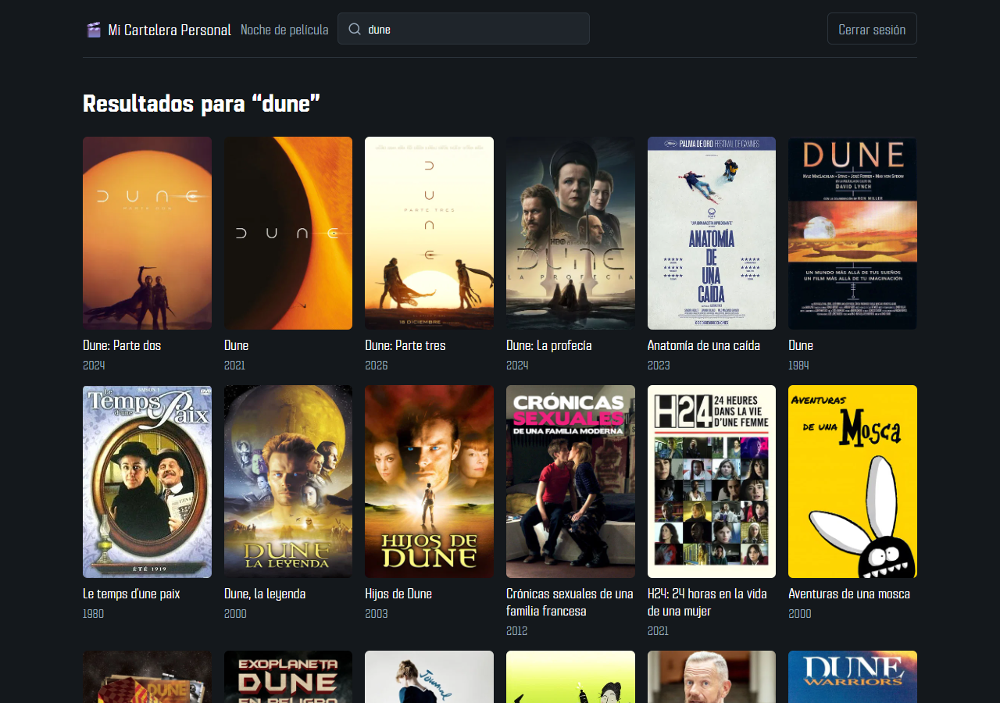
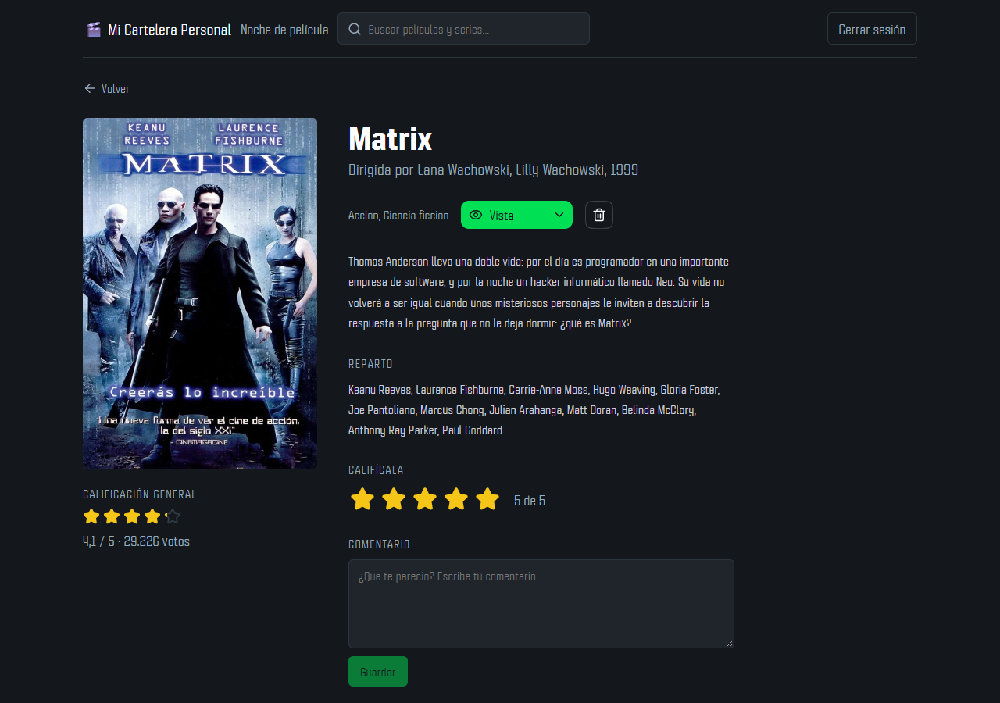
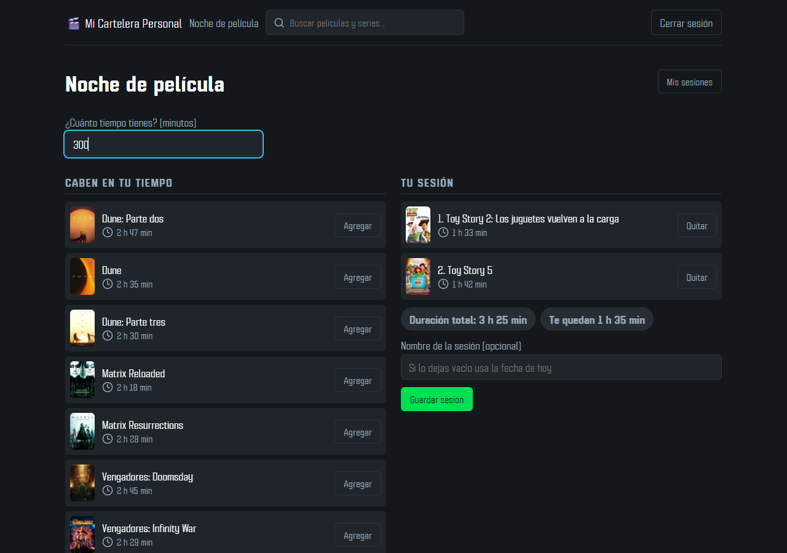
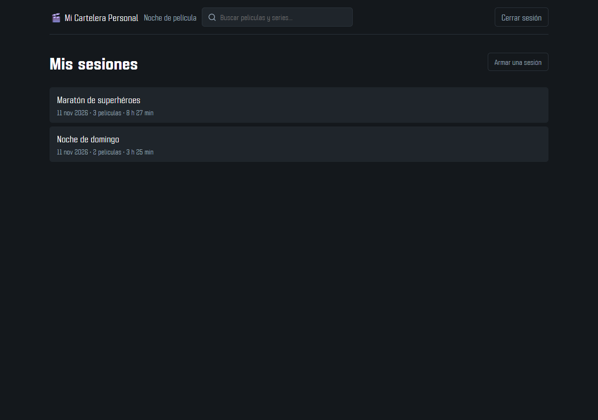
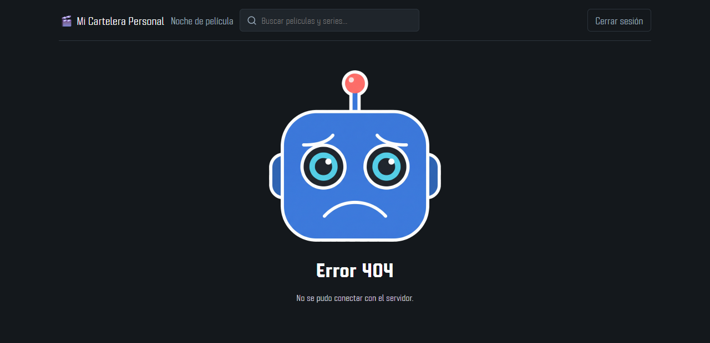
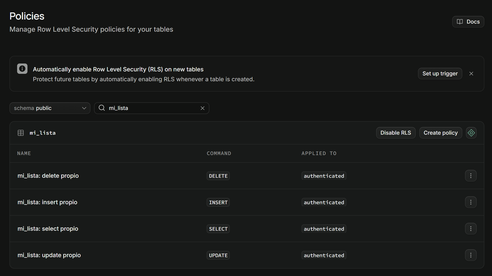

# 🎬 Mi Cartelera Personal

Aplicación web donde cada usuario registra, organiza y califica las películas y series que quiere ver, está viendo o ya vio. Busca títulos reales en la API de [The Movie Database (TMDB)](https://www.themoviedb.org/) (póster, sinopsis, reparto, calificación oficial) y guarda su propia versión —estado, calificación y comentario personal— en una base de datos PostgreSQL de Supabase, protegida por autenticación y Row Level Security.

Proyecto de la materia Desarrollo Web 2 (USFQ). El Entregable 3 construyó la lista personal; el Entregable 4 le suma **Noche de película**, descrita [más abajo](#noche-de-película-entregable-4).

**Demo en vivo:** [cartelera-personal-brown.vercel.app](https://cartelera-personal-brown.vercel.app)

## Tecnologías

| Capa | Tecnología | Uso |
|---|---|---|
| Frontend | React 19 + TypeScript (Vite) | Componentes funcionales con hooks, props e interfaces tipadas |
| Routing | React Router | Rutas protegidas, búsqueda y detalle como URLs compartibles |
| API externa | TMDB | Búsqueda, recomendaciones, detalle y reparto |
| Autenticación | Supabase Auth | Registro, login, logout y sesión persistente |
| Base de datos | Supabase (PostgreSQL) | Tabla `mi_lista` con políticas RLS por usuario |
| Estilos | CSS plano (una sola hoja) | `src/index.css` |
| Pruebas | Vitest | Tests de las reglas puras del dominio (Noche de película, estados de la lista, filas, errores de conexión), sin base de datos ni red |
| Formato | Prettier | Lo aplica un hook del agente a cada archivo que edita |
| Agente | Claude Code | Desarrollo guiado por specs; ver [Harness del agente](#harness-del-agente) |

## Funcionalidades

- **Acceso controlado:** ninguna pantalla de contenido es visible sin sesión; el logout está siempre visible en el header.
- **Búsqueda en TMDB:** al presionar Enter se muestra una grilla de películas y series, con estados de carga y error. El año escrito se usa como pista (`matrix 1999`) sin esconder títulos que lleven números (`Blade Runner 2049`).
- **Mi lista:** el botón «+» de una tarjeta agrega el título como «por ver» y la papelera lo quita. El estado (cualquiera de los tres, desde cualquier otro) se elige en el detalle con un selector.
- **Calificación y comentario personales** (1 a 5 y texto libre), independientes de la nota de TMDB.
- **Página de detalle:** póster grande, sinopsis, director o creador, géneros, reparto, nota general de TMDB con estrellas y tu calificación y comentario.
- **Resumen y filtros:** contador de pendientes, en progreso y vistas; filtro por estado y orden por fecha o calificación.
- **Recomendaciones:** fila de películas populares de TMDB elegidas al azar, sin los títulos que ya guardaste.
- **Tarjetas con la información siempre visible:** título, año y, si calificaste el título, tus estrellas, debajo del póster.
- **Filas con flechas:** sin barra de desplazamiento; las flechas aparecen con el mouse o con el foco y solo hacia donde hay más tarjetas. En el celular se desliza.
- **Avisos:** cada acción (agregar, mover, quitar) se confirma con un aviso abajo de la pantalla, y los fallos también avisan.
- **Pantalla de error:** si al cargar una página no se puede conectar con Supabase o con TMDB, se muestra «Error 404 · No se pudo conectar con el servidor.» en lugar de un texto técnico.
- **Seguridad real (RLS):** cada usuario solo ve, edita y borra sus propias filas, verificado contra la base de datos.

## Noche de película (Entregable 4)

Cuando tienes un rato libre, dices cuánto tiempo tienes y la app te muestra qué películas de tu lista «por ver» caben. Con ellas armas una sesión y la guardas para esa noche.

**Cómo se usa**

1. Entra a **Noche de película** (enlace del encabezado, ruta `/noche`).
2. Escribe tu tiempo en minutos: un número entero de 30 a 600.
3. Agrega las películas que quieras. Ves en todo momento la duración total y el tiempo que te queda.
4. Guarda la sesión con un nombre (opcional). Las consultas en **Mis sesiones** (`/noche/sesiones`).

**Reglas** (completas en el [PRD](docs/prd/PRD.md))

- Solo cuentan las películas de tu lista en estado «por ver»; las series no.
- La duración viene de TMDB. Una película sin duración conocida no se puede agregar y la app explica por qué.
- Hay 10 minutos de pausa entre una película y la siguiente; ninguna antes de la primera ni después de la última.
- Una sesión cabe si la suma de duraciones más las pausas no supera tu tiempo. Ocupar exactamente el tiempo sí cabe.
- Guardar una sesión no cambia el estado de sus películas.

**Decisiones** ([PRD](docs/prd/PRD.md), sección 8): una película puede estar en varias sesiones; las que caben se ordenan de la más antigua en tu lista a la más reciente; una sesión guardada no se modifica ni se elimina y conserva una copia de cada película, así que quitar una película de tu lista no la cambia; cada sesión tiene nombre opcional («Noche del 11 de nov» por defecto) y fecha de creación.

**Datos y seguridad.** Dos tablas nuevas, `sesiones` y `sesion_peliculas` ([`docs/migrations/001_sesiones.sql`](docs/migrations/001_sesiones.sql)). Cada persona solo lee y crea lo suyo (RLS), y no hay políticas de modificar ni de eliminar. El guardado es una función SQL que escribe la sesión y todas sus películas en una sola transacción: o se guarda completa o no se guarda. La prueba con dos cuentas está en [`scripts/test-rls-sesiones.ts`](scripts/test-rls-sesiones.ts).

**Dónde está el código**

```
src/domain/nochePelicula.ts   la regla de «cabe» (funciones puras, con tests)
src/domain/candidatas.ts      qué películas se ofrecen y en qué orden
src/domain/sesion.ts          armar y guardar una sesión, nombre por defecto
src/infrastructure/           duración en TMDB y servicio de sesiones en Supabase
src/hooks/                    useDuraciones, useSesionEnArmado, useGuardarSesion, ...
src/components/noche/         componentes de la pantalla
src/pages/                    NochePage, SesionesPage, SesionDetailPage
```

La demo en vivo corresponde al Entregable 3: Noche de película todavía no está desplegada.

## Mejoras de interfaz (Entregable 4)

A partir del feedback del profesor sobre el Entregable 3 y de criterio propio, se rehízo parte de la interfaz de la lista. Cada cambio tiene su ticket y su spec antes del código ([tickets](docs/backlog/tickets-e1-mejoras-ui.md), [spec](docs/specs/spec-e1-mejoras-ui.md)).

| Ticket | Qué cambió |
|---|---|
| E1-D01 | Título, año y estrellas siempre visibles debajo del póster (antes salían solo con hover). |
| E1-D02 | El estado ya no «solo avanza»: en el detalle se elige cualquiera de los tres con un selector. Las tarjetas alternan «+» (agrega como «por ver») y la papelera. |
| E1-D03 | Avisos (snackbar) al agregar, mover y quitar, y cuando algo falla. |
| E1-D04 | Filas sin barra de desplazamiento, con flechas: se alcanzan primero con Tab y la fila vuelve al inicio cuando llega una tarjeta nueva. |
| E1-D05 | Escala tipográfica con dos variables (`--font-base` y `--font-ratio`) en `src/index.css`. |
| E1-D06 | Pantalla de error cuando no hay conexión con el servidor. La imagen va en `public/error-servidor.png`; sin ella la pantalla se ve igual, sin imagen. |

## Capturas

### Login y registro



### Inicio

Cada tarjeta muestra bajo el póster su título, su año y, si lo calificaste, tus estrellas. Sobre el póster, con el mouse o el foco, aparece un botón: «+» para agregar el título como pendiente o la papelera para quitarlo. Las filas se navegan con flechas.





### Búsqueda



### Detalle de un título



### Noche de película

Con el tiempo disponible escrito, a la izquierda lo que cabe y a la derecha la sesión que se arma, con su duración total y lo que te queda.



### Mis sesiones



### Pantalla de error

Cuando una página no logra conectar con Supabase o con TMDB al cargar. Si fallan solo una acción (agregar, quitar, guardar), la página se queda donde está y el aviso dice lo mismo.



## Instalación

### Requisitos previos

- Node.js 20.19 o superior (recomendado 22 LTS)
- Una cuenta gratuita en [Supabase](https://supabase.com/)
- Una API key gratuita de [TMDB](https://www.themoviedb.org/settings/api)

### 1. Clonar e instalar dependencias

```bash
git clone <url-del-repositorio>
cd cartelera-personal
npm install
```

### 2. Configurar Supabase

1. Crea un proyecto en Supabase.
2. En **SQL Editor**, pega y ejecuta [`docs/schema.sql`](docs/schema.sql). Crea la tabla `mi_lista`, activa RLS y define las 4 políticas.
   Para Noche de película, ejecuta después [`docs/migrations/001_sesiones.sql`](docs/migrations/001_sesiones.sql): crea las tablas de sesiones, su RLS y la función `guardar_sesion`.
3. En **Authentication → Sign In / Providers → Email**, desactiva **Confirm email** para desarrollar y probar (con la confirmación activa, el registro no inicia sesión hasta confirmar el correo).
4. En **Authentication → URL Configuration**, pon `http://localhost:5173` como Site URL.

### 3. Variables de entorno

Copia el archivo de ejemplo y completa los valores:

```bash
cp .env.example .env
```

| Variable | Dónde obtenerla |
|---|---|
| `VITE_SUPABASE_URL` | Supabase → Project Settings → API → **Project URL**. Con la forma `https://xxxx.supabase.co`, **sin** `/rest/v1/` al final. |
| `VITE_SUPABASE_ANON_KEY` | Supabase → Project Settings → API Keys → **Publishable key** (`sb_publishable_…`) o la clave `anon` legacy. |
| `VITE_TMDB_API_KEY` | TMDB → Settings → API → **API Key (v3)**, la de 32 caracteres. |

> **Nunca** uses la clave `service_role` / `secret` en el frontend: salta RLS. El archivo `.env` está en `.gitignore`; solo `.env.example` (sin valores) se versiona. La clave publishable/anon es pública por diseño y la protege RLS.

## Cómo correr

```bash
npm run dev       # servidor de desarrollo en http://localhost:5173
npm run build     # typecheck + build de producción en dist/
npm run preview   # sirve el build localmente
npm run lint      # ESLint
npm test          # tests de la regla de negocio (Vitest)
```

Reinicia `npm run dev` si cambias el `.env`: Vite solo lo lee al arrancar.

## Pruebas

| Qué | Comando | Qué comprueba |
|---|---|---|
| Regla de negocio | `npm test` | 152 tests de Vitest (el dominio de Noche de película y el de E1: estados de la lista, flechas de las filas y errores de conexión). De «cabe»: la regla de «cabe» y sus bordes (sesión que ocupa exactamente el tiempo, una sola película, película sin duración, tiempo fuera de rango), las candidatas y su orden, armar y guardar una sesión, y el límite de consultas simultáneas. No usan red ni base de datos. |
| Seguridad de la lista | `node --experimental-strip-types scripts/test-rls.ts` | RLS de `mi_lista` con dos cuentas (12 verificaciones). |
| Seguridad de las sesiones | `node --experimental-strip-types scripts/test-rls-sesiones.ts` | Con dos cuentas: privacidad, solo lectura, no falsificar al dueño, guardado atómico y límites (26 verificaciones). Como las sesiones no se pueden eliminar, imprime el SQL para borrar los usuarios de prueba. |
| Navegador | [`docs/VERIFICACION.md`](docs/VERIFICACION.md) | Cada criterio con sus pasos y su resultado obtenido. |

Los resultados criterio por criterio (139 criterios, todos «cumple» en la última pasada) están en [`docs/AUDITORIA.md`](docs/AUDITORIA.md).

## Estructura del proyecto

La estructura sigue una separación por capas: el dominio es puro y la infraestructura (Supabase, TMDB) queda en los bordes.

```
src/
├── domain/             # tipos y reglas puras, sin React ni red
│   ├── miLista.ts      #   Estado, ItemLista, decidirCambioEstado(), ordenarLista()
│   ├── busqueda.ts     #   interpretarBusqueda(): el año es una pista, no un filtro
│   ├── detalle.ts      #   DetalleTitulo
│   ├── fila.ts         #   extremosDeFila(), llegoNuevaAlInicio(): las flechas de las filas
│   └── errores.ts      #   esErrorDeConexion(), mensajeDeError()
├── infrastructure/     # acceso a servicios externos
│   ├── miListaRepository.ts  # CRUD sobre Supabase (mi_lista)
│   └── tmdb.ts               # búsqueda, recomendaciones y detalle en TMDB
├── lib/                # cliente de Supabase y helpers de rutas
├── auth/               # AuthProvider (Context), useAuth, ProtectedRoute
├── lista/              # MiListaProvider (Context): una sola copia de la lista
├── notificaciones/     # NotificacionesProvider y useNotificaciones: el snackbar
├── hooks/              # useBusqueda, useDetalleTitulo, useRecomendaciones, useAccionesTarjeta
├── components/         # tarjetas, filas, pills, estrellas, buscador, formularios
├── pages/              # Login, Registro, Inicio, Búsqueda, Detalle, Noche, Sesiones, ErrorPage
└── index.css           # única hoja de estilos
docs/
├── schema.sql          # tabla mi_lista + RLS
├── migrations/         # sesiones de Noche de película
└── ...                 # PRD, backlog, specs, verificación y auditoría
scripts/
├── test-rls.ts         # prueba de RLS de mi_lista contra la API REST
└── test-rls-sesiones.ts  # prueba de RLS de las sesiones
```

## Modelo de datos

Una sola tabla propia, `mi_lista`, relacionada con `auth.users` (que Supabase ya mantiene):

| Columna | Tipo | Descripción |
|---|---|---|
| `id` | bigint (identity, PK) | Identificador de la fila |
| `user_id` | uuid (FK → `auth.users.id`) | Dueño del registro; es la columna que usa RLS. Default `auth.uid()` |
| `tmdb_id` | integer | ID del título en TMDB |
| `titulo` | text | Título tal como aparece en TMDB |
| `poster_url` | text | URL del póster |
| `tipo_contenido` | text (`pelicula` \| `serie`) | Distingue películas de series |
| `estado` | text (`por_ver` \| `viendo` \| `vista`) | Estado de visualización |
| `calificacion_personal` | integer (1 a 5, nullable) | Calificación del usuario |
| `comentario` | text (nullable) | Comentario libre |
| `fecha_agregado` | timestamptz (default `now()`) | Para ordenar |

Hay una restricción `unique (user_id, tmdb_id, tipo_contenido)`: no se puede guardar dos veces el mismo título. El tipo forma parte de la clave porque TMDB reutiliza IDs entre películas y series.

## Seguridad (RLS)

`mi_lista` tiene Row Level Security activado y una política por operación (`select`, `insert`, `update`, `delete`), todas para `authenticated` y con la condición `auth.uid() = user_id`. Una política de `update` incluye además `with check` para impedir reasignar una fila a otro usuario.



### Verificación

El script [`scripts/test-rls.ts`](scripts/test-rls.ts) comprueba que la protección vive en la base de datos y no solo en el frontend. Habla directo con la API REST (sin pasar por la interfaz) y usa el token de dos usuarios de prueba que crea al vuelo. Verifica que:

- sin sesión no se ve ni se inserta nada;
- cada usuario ve únicamente sus propias filas, incluso pidiendo por `id` la fila de otro;
- un usuario no puede editar ni borrar la fila de otro, y la fila ajena queda intacta;
- no se puede insertar una fila a nombre de otro usuario ni reasignar una propia;
- cada dueño sí puede editar lo suyo (descarta que todo falle por mala configuración).

Requiere **Confirm email** desactivado y el `.env` configurado. Desde la raíz del proyecto:

```bash
node --experimental-strip-types scripts/test-rls.ts
```

Resultado de la última ejecución:

```text
USFQ+00336640@Emilio-Puga MINGW64 ~/OneDrive - Universidad San Francisco de Quito/Documentos/USFQ/7mo Semestre/Desarrollo Web 2/cartelera-personal (master)
$ node --experimental-strip-types scripts/test-rls.ts
(node:29764) ExperimentalWarning: Type Stripping is an experimental feature
 and might change at any time
(Use `node --trace-warnings ...` to show where the warning was created)    
Usuario A: rls-test-a-1792032537398@example.com
Usuario B: rls-test-b-1792032538194@example.com

PASS  A inserta su propia fila
        HTTP 201
PASS  B inserta su propia fila
        HTTP 201
PASS  Sin sesión no se ve ninguna fila
        HTTP 200, 0 filas
PASS  B solo ve sus propias filas
        1 fila(s) visibles para B
PASS  B no puede leer la fila de A pidiéndola por id
        0 filas devueltas
PASS  B no puede editar la fila de A
        0 filas afectadas
PASS  B no puede borrar la fila de A
        0 filas afectadas
PASS  La fila de A sigue intacta (existe y su comentario no cambió)        
        comentario actual: "original de A"
PASS  B no puede insertar una fila a nombre de A
        HTTP 403: new row violates row-level security policy for table "mi_
lista"
PASS  B no puede reasignar su propia fila a A
        HTTP 403: new row violates row-level security policy for table "mi_
lista"
PASS  Sin sesión no se puede insertar
        HTTP 401: new row violates row-level security policy for table "mi_
lista"
PASS  A sí puede editar su propia fila
        HTTP 200

12/12 verificaciones correctas.
```

Al terminar, el script borra sus propias filas. Los usuarios de prueba quedan en `auth.users`; para eliminarlos, en el SQL Editor:

```sql
delete from auth.users where email like 'rls-test-%@example.com';
```

## Harness del agente

El Entregable 4 se desarrolló con Claude Code guiado por specs. El entorno del agente vive en el repositorio:

- [`AGENTS.md`](AGENTS.md): reglas del proyecto en 40 líneas o menos. La principal es «ninguna funcionalidad sin spec»; también las reglas de claves (TMDB y Supabase solo en variables de entorno), las capas y el estilo de código.
- [`CLAUDE.md`](CLAUDE.md): importa `AGENTS.md` y agrega notas para el agente.
- Skill `/commit` ([`.claude/skills/commit/SKILL.md`](.claude/skills/commit/SKILL.md)): el formato de los commits, con `disable-model-invocation` para que no se dispare sola. Nunca hace push.
- Hook `PostToolUse` ([`.claude/settings.json`](.claude/settings.json) y [`.claude/hooks/format.mjs`](.claude/hooks/format.mjs)): formatea con Prettier cada archivo que el agente edita. La configuración está en `.prettierrc`.

## Documentación del proceso

El historial de git sigue el orden **harness → estado inicial → PRD → backlog → spec → código → verificación**.

| Documento | Qué es |
|---|---|
| [`docs/ESTADO-INICIAL.md`](docs/ESTADO-INICIAL.md) | Qué hacía el Proyecto 3 antes de empezar, sus riesgos y su deuda. |
| [`DESIGN.md`](DESIGN.md) y [brand board](docs/diseno/brand-board.html) | El sistema de diseño real de la app. |
| [`docs/prd/PRD.md`](docs/prd/PRD.md) | El producto: problema, alcance, reglas de negocio y las decisiones del cliente. |
| [`docs/backlog/`](docs/backlog/) | Historias con sus criterios, el refinamiento con la IA y los tickets. |
| [`docs/specs/spec-e2-noche-de-pelicula.md`](docs/specs/spec-e2-noche-de-pelicula.md) | Cómo se construye: datos, funciones puras, servicios, interfaz y verificación. |
| [`docs/specs/spec-e1-mejoras-ui.md`](docs/specs/spec-e1-mejoras-ui.md) | Cómo se construyen las mejoras de interfaz de la lista (tarjetas, selector, avisos, flechas, pantalla de error). |
| [`docs/VERIFICACION.md`](docs/VERIFICACION.md) y [`docs/AUDITORIA.md`](docs/AUDITORIA.md) | Cómo se comprobó y con qué resultado. |

## Créditos

Los datos de películas y series provienen de la API de TMDB. This product uses the TMDB API but is not endorsed or certified by TMDB.
