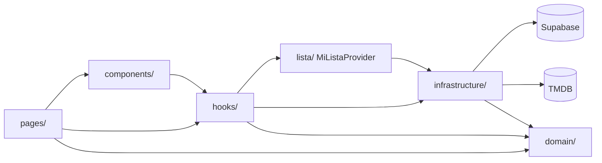

# Estado inicial — Mi Cartelera Personal (Proyecto 3)

Foto del proyecto **antes** de empezar el Entregable 4, tomada sobre el commit `e7fcca8` (rama `master`). Describe qué hace hoy la app, cómo está armada, sus inconsistencias, sus riesgos y la deuda pendiente. Nada de lo listado aquí se corrige en este documento: las correcciones se planifican como tickets en [`docs/backlog/`](backlog/).

## 1. Qué hace hoy

Aplicación web donde cada usuario registra, organiza y califica películas y series. Los datos públicos (póster, sinopsis, reparto, nota general) vienen de TMDB; la versión personal (estado, calificación, comentario) se guarda en Supabase, protegida con RLS.

| Pantalla | Ruta | Qué permite |
| --- | --- | --- |
| Login / Registro | `/login`, `/registro` | Crear cuenta con nombre visible, iniciar sesión. Sesión persistente. |
| Inicio | `/` | Saludo, contador por estado, filtro por estado, orden (fecha / mi calificación), filas: recomendadas, agregadas recientemente, pendientes, en progreso, vistas. |
| Búsqueda | `/buscar?q=` | Grilla de películas y series de TMDB, paginada con «Ver más». El año escrito es una pista, no un filtro. |
| Detalle | `/titulo/:tipo/:id` | Póster, sinopsis, créditos, géneros, reparto, nota TMDB con estrellas, estado, calificación y comentario personales, quitar de la lista con confirmación. |

Todas las rutas salvo login y registro están detrás de `ProtectedRoute`.

### Comportamiento actual de las tarjetas

- Por defecto la tarjeta muestra **solo el póster**. Título, año y calificación aparecen en un overlay al pasar el mouse o con foco.
- El botón de estado sigue un flujo **lineal y de un solo sentido**: ninguna → `por_ver` → `viendo` → `vista`. En `vista` el botón queda deshabilitado; no se puede volver atrás.
- Al agregar o cambiar de estado **no hay mensaje de confirmación**: solo cambia el ícono y el color del botón.
- Cada fila del inicio se desplaza con la **barra de scroll horizontal nativa**.
- El botón de eliminar de la tarjeta borra sin confirmar; el del detalle sí pide confirmación.

## 2. Stack

| Capa | Tecnología |
| --- | --- |
| Frontend | React 19 + TypeScript 6 (Vite 8), componentes funcionales y hooks |
| Routing | React Router 7 |
| Estado compartido | Context API (`AuthProvider`, `MiListaProvider`) |
| API externa | TMDB v3 (búsqueda, discover, popular, detalle con créditos) |
| Auth y datos | Supabase Auth + PostgreSQL (`mi_lista`, 4 políticas RLS) |
| Estilos | CSS propio en una sola hoja (`src/index.css`) con tokens en `:root`; íconos `lucide-react` |
| Calidad | ESLint (typescript-eslint, react-hooks, react-refresh). Sin Prettier, sin tests unitarios |
| Deploy | Vercel (`vercel.json` con rewrite SPA) |

## 3. Arquitectura

Separación por capas con el dominio puro y la infraestructura en los bordes.

| Carpeta | Responsabilidad |
| --- | --- |
| `domain/` | Tipos y reglas puras: `Estado`, `ItemLista`, `siguienteEstado`, `ordenarLista`, `contarPorEstado`, `interpretarBusqueda`, `DetalleTitulo`. |
| `infrastructure/` | `miListaRepository.ts` (CRUD sobre `mi_lista`) y `tmdb.ts` (mapeo de respuestas TMDB a tipos del dominio). |
| `lista/` | Una sola copia de la lista para todas las pantallas; marca acciones en curso (`busy`) y guarda el último error (`actionError`). |
| `hooks/` | Orquestan carga y acciones: búsqueda, detalle, recomendaciones, acciones de tarjeta. |
| `components/`, `pages/` | Presentación. No llaman a Supabase ni a TMDB directamente. |

### Modelo de datos

Una tabla propia, `mi_lista` (ver [`schema.sql`](schema.sql)): `id`, `user_id` (default `auth.uid()`), `tmdb_id`, `titulo`, `poster_url`, `tipo_contenido`, `estado` (check en los 3 valores, **sin** restricción de transición), `calificacion_personal` (1–5, nullable), `comentario`, `fecha_agregado`. Única por `(user_id, tmdb_id, tipo_contenido)`. RLS con una política por operación; `update` con `with check`.

La protección RLS está verificada con [`scripts/test-rls.ts`](../scripts/test-rls.ts) (dos usuarios contra la API REST, 12/12 verificaciones).

## 4. Inconsistencias

| # | Inconsistencia | Decisión |
| --- | --- | --- |
| I-01 | El brief del Entregable 4 menciona Bootstrap; el Proyecto 3 usa CSS propio con tokens. | Se mantiene el CSS propio. `DESIGN.md` documentará ese sistema. Mezclar Bootstrap rompería la coherencia visual y duplicaría estilos. |
| I-02 | El brief pide la regla de negocio en `src/dominio/`; el proyecto usa `src/domain/`. | Se mantiene `src/domain/` para no mover archivos existentes. Es la misma capa. |
| I-03 | El comentario de `RemoveFromList.tsx` dice que en las tarjetas «no hay nada más que perder», pero una tarjeta de mi lista puede tener calificación y comentario y se borra sin confirmar. | Registrado como deuda D-05. |
| I-04 | El detalle bloquea el botón de estado mientras la lista carga (evita doble insert); la búsqueda no. | Registrado como deuda D-06. |
| I-05 | Las tarjetas de búsqueda muestran el año; las de mi lista no, porque `mi_lista` no guarda el año. | Aceptado (D-12). |
| I-06 | El README dice «Enregable 3» y describe/captura el overlay con hover, que va a cambiar. | Se actualiza al cierre del entregable. |

## 5. Riesgos

| # | Riesgo | Impacto |
| --- | --- | --- |
| R-01 | `/.claude` está en `.gitignore`: el harness del Entregable 4 (skill `/commit`, hook de Prettier) no se versionaría. | Alto para la entrega: el harness debe estar en el repositorio. Se corrige al montar el harness. |
| R-02 | `AuthProvider` usa `getSession().then(...)` sin manejo de error: si falla, `loading` queda en `true` y la app se queda en «Cargando…». | Medio. |
| R-03 | Las respuestas de Supabase se castean (`as ItemLista[]`) sin validación ni tipos generados. | Bajo: un cambio de esquema no lo detecta el compilador. |
| R-04 | Los mensajes de error de Supabase y TMDB llegan crudos a la UI (en inglés, con detalles técnicos). | Bajo, de experiencia de usuario. |
| R-05 | La API key de TMDB va en una variable `VITE_` y termina en el bundle del cliente. | Inherente a una app sin backend. No está en el repositorio (`.env` ignorado). |
| R-06 | Sin tests unitarios: cualquier cambio en `domain/` depende de prueba manual. | Medio. El Entregable 4 introduce Vitest. |
| R-07 | El registro asume «Confirm email» desactivado en Supabase. | Bajo, documentado en el README. |

## 6. Deuda pendiente

Lista de pendientes heredados. Los marcados con ticket se resuelven en este entregable como **decisiones de diseño UI/UX**, a partir de la retroalimentación del profesor sobre el Proyecto 3 y de criterio propio.

| # | Deuda | Origen | Ticket |
| --- | --- | --- | --- |
| D-01 | Las tarjetas esconden título, año y calificación hasta pasar el mouse. | Feedback del profesor | [E1-D01](backlog/tickets-e1-mejoras-ui.md) |
| D-02 | El estado solo avanza: una película «vista» no puede volver a «viendo». | Feedback del profesor | [E1-D02](backlog/tickets-e1-mejoras-ui.md) |
| D-03 | Al agregar o cambiar de estado no hay mensaje de confirmación. | Feedback del profesor | [E1-D03](backlog/tickets-e1-mejoras-ui.md) |
| D-04 | Las filas del inicio muestran la barra de scroll horizontal nativa; no hay controles explícitos para navegarlas. | Criterio propio | [E1-D04](backlog/tickets-e1-mejoras-ui.md) |
| D-05 | Eliminar desde una tarjeta no pide confirmación aunque el título tenga calificación o comentario. | Revisión de código | Pendiente |
| D-06 | En búsqueda se puede agregar un título mientras la lista aún carga; si ya estaba guardado, el `unique` de la tabla lo rechaza con un error crudo. | Revisión de código | Pendiente |
| D-07 | No hay Vitest ni tests unitarios del dominio. | Revisión de código | Se cubre con la épica E2 |
| D-08 | No hay Prettier ni formato automático. | Brief E4 | Se cubre con el harness |
| D-09 | Errores de acción se muestran como alerta arriba de la página; si el usuario está abajo en una fila, no lo ve. | Revisión de código | Se cubre en E1-D03 |
| D-10 | `AuthProvider` sin manejo de error en `getSession` (R-02). | Revisión de código | Pendiente |
| D-11 | Mensajes de error crudos de Supabase/TMDB (R-04). | Revisión de código | Pendiente |
| D-12 | `mi_lista` no guarda año ni nota de TMDB: las tarjetas de mi lista no pueden mostrarlos. | Revisión de código | Aceptado: no se migra la tabla en este entregable |
| D-13 | `index.css` tiene 25 `font-size` con 9 valores sueltos; los colores y radios sí son tokens, la tipografía no. | Criterio propio | [E1-D05](backlog/tickets-e1-mejoras-ui.md) |

## 7. Lo que debe seguir funcionando

Checklist de regresión: al final del Entregable 4 todo esto se comporta igual (salvo lo que cambian explícitamente los tickets E1-D01 a E1-D05).

- [ ] Registro, login, logout y sesión persistente al recargar.
- [ ] Rutas protegidas redirigen a `/login` sin sesión.
- [ ] Búsqueda con año como pista, paginación «Ver más», estados de carga y error.
- [ ] Agregar, cambiar estado y quitar desde tarjetas y detalle.
- [ ] Calificación (1–5, quitar con segundo click) y comentario en el detalle.
- [ ] Contador por estado, filtro por estado y orden por fecha o calificación.
- [ ] Recomendaciones sin títulos ya guardados.
- [ ] `scripts/test-rls.ts` en 12/12.

## 8. Notas para la épica E2 (Noche de película)

- `fetchDetalleTitulo` no mapea `runtime`: la duración que necesita E2 hay que agregarla en `infrastructure/tmdb.ts` y en el dominio.
- `mi_lista` mezcla películas y series; E2 excluye series, así que debe filtrar `tipo_contenido = 'pelicula'` además de `estado = 'por_ver'`.
