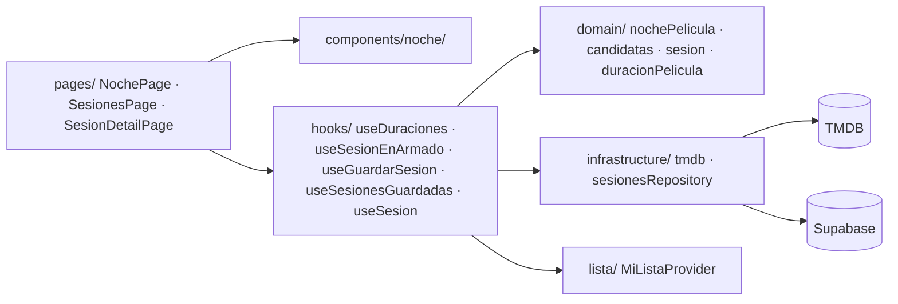

# Spec — E2 Noche de película

Describe **cómo** se construye E2. Parte del [PRD](../prd/PRD.md), las [historias](../backlog/historias-e2.md), el [refinamiento](../backlog/refinamiento-e2.md) y los [tickets](../backlog/tickets-e2.md). La interfaz sigue [`DESIGN.md`](../../DESIGN.md) por nombre; esta spec no copia sus valores.

Regla del proyecto: ninguna funcionalidad sin spec. Si una decisión de código no está aquí, se agrega aquí antes de escribirla.

## 1. Arquitectura

E2 respeta las capas de E1: el dominio es puro y la infraestructura está en los bordes. **La regla de «cabe» vive solo en el dominio**; la interfaz muestra sus resultados y no repite cuentas.



Decisiones de arquitectura:

- **Se mantiene `src/domain/`** y no se crea `src/dominio/` (inconsistencia I-01 de `ESTADO-INICIAL.md`): es la misma capa.
- **La lista de la persona no se vuelve a pedir.** `NochePage` lee `useMiLista()` (E1) y calcula las películas por ver con la función pura de dominio.
- **La sesión en armado vive en el estado de `NochePage`.** No se persiste ni sobrevive a recargar o a cambiar de pantalla (RF-23). Al guardar con éxito se vacía.
- **E1 no cambia.** Solo se tocan `App.tsx` (3 rutas), `AppLayout.tsx` (un enlace), `lib/rutas.ts`, `infrastructure/tmdb.ts` (se agregan funciones, no se modifican las existentes) e `index.css` (una sección nueva al final).
- **Sin cambios en `mi_lista`.** Guardar una sesión nunca la modifica (RN-09).

## 2. Modelo de datos

Dos tablas nuevas. **Una sesión guarda una copia** del título, la duración y el póster de cada película (DEC-04): no hay clave foránea a `mi_lista`, así que quitar o cambiar de estado una película no altera la sesión.

Decisiones:

- **No se guarda la duración total.** Se calcula con la función pura a partir de las películas; guardarla sería un segundo dato que podría contradecir al primero.
- **Sin política de modificar ni eliminar** (DEC-03). Con RLS activo, una operación sin política queda denegada.
- **El guardado es una función de base de datos** (`guardar_sesion`), no dos inserciones sueltas: una sesión nunca queda a medias. Con dos inserciones, un fallo en la segunda dejaría una sesión vacía que no se podría borrar, porque no hay política de borrado. La función corre con los permisos de quien la llama (`security invoker`), así que RLS se sigue aplicando adentro.
- **El nombre siempre existe:** si la persona no escribe uno, el cliente guarda «Noche del 11 de nov» (DEC-05).
- La validación de que la sesión **cabe** no va en la base de datos: es un punto extra del brief y no entra en esta versión. Sí van en la base los límites simples (nombre de 1 a 60 caracteres, tiempo de 30 a 600, duración positiva, película única por sesión).

### Migración SQL

Se guarda tal cual en `docs/migrations/001_sesiones.sql` (ticket E2-T03) y se corre a mano en Supabase: SQL Editor → New query → pegar → Run.

```sql
-- Noche de película (E2): sesiones guardadas.
-- Se corre a mano en Supabase: SQL Editor -> New query -> pegar -> Run.

-- ============================================================
-- Tablas
-- ============================================================
create table public.sesiones (
  id                bigint generated always as identity primary key,

  -- default auth.uid(): igual que mi_lista, el frontend no envía user_id
  -- y el with check de la policy de insert impide falsificarlo.
  user_id           uuid not null default auth.uid()
                      references auth.users (id) on delete cascade,

  -- Siempre hay nombre: si la persona no escribe uno, el cliente guarda
  -- "Noche del 11 de nov". char_length cuenta caracteres, no bytes.
  nombre            text not null
                      check (char_length(nombre) between 1 and 60),
  tiempo_disponible integer not null
                      check (tiempo_disponible between 30 and 600),
  creada_en         timestamptz not null default now()
);

-- "Mis sesiones": filtra por dueño y ordena de la más reciente a la más antigua.
create index sesiones_user_id_creada_en_idx on public.sesiones (user_id, creada_en desc);

create table public.sesion_peliculas (
  id            bigint generated always as identity primary key,
  -- on delete cascade: si se borra la sesión (o la cuenta), se borran sus películas.
  sesion_id     bigint not null references public.sesiones (id) on delete cascade,

  -- Copia de lo que se vio al armar la sesión. Sin FK a mi_lista a propósito:
  -- la sesión es un plan histórico y no debe cambiar si la lista cambia.
  tmdb_id       integer not null,
  titulo        text not null,
  poster_url    text,
  duracion_min  integer not null check (duracion_min > 0),
  orden         integer not null check (orden >= 1),

  -- Una película una sola vez por sesión; el orden no se repite.
  -- (sesion_id, orden) también sirve de índice para buscar por sesion_id.
  unique (sesion_id, tmdb_id),
  unique (sesion_id, orden)
);

-- ============================================================
-- Row Level Security
-- ============================================================
alter table public.sesiones enable row level security;
alter table public.sesion_peliculas enable row level security;

-- Solo select e insert. No hay policies de update ni delete: las sesiones
-- guardadas son de solo lectura (DEC-03) y sin policy esa operación se deniega.
create policy "sesiones: select propio"
  on public.sesiones for select
  to authenticated
  using ((select auth.uid()) = user_id);

create policy "sesiones: insert propio"
  on public.sesiones for insert
  to authenticated
  with check ((select auth.uid()) = user_id);

-- Las películas heredan el permiso de su sesión: solo se ven o se crean
-- si la sesión a la que apuntan es del usuario.
create policy "sesion_peliculas: select propio"
  on public.sesion_peliculas for select
  to authenticated
  using (
    exists (
      select 1 from public.sesiones s
      where s.id = sesion_peliculas.sesion_id
        and s.user_id = (select auth.uid())
    )
  );

create policy "sesion_peliculas: insert propio"
  on public.sesion_peliculas for insert
  to authenticated
  with check (
    exists (
      select 1 from public.sesiones s
      where s.id = sesion_peliculas.sesion_id
        and s.user_id = (select auth.uid())
    )
  );

-- ============================================================
-- Guardado atómico
-- ============================================================
-- Una sola transacción: o se guardan la sesión y todas sus películas, o nada.
-- security invoker: corre con los permisos de quien llama, así RLS sigue aplicando.
-- p_peliculas es un arreglo JSON de { tmdb_id, titulo, poster_url, duracion_min }
-- en el orden en que se agregaron; la posición en el arreglo se guarda como orden.
create function public.guardar_sesion(
  p_nombre            text,
  p_tiempo_disponible integer,
  p_peliculas         jsonb
) returns bigint
language plpgsql
security invoker
set search_path = public
as $$
declare
  v_id bigint;
begin
  if p_peliculas is null
     or jsonb_typeof(p_peliculas) <> 'array'
     or jsonb_array_length(p_peliculas) = 0 then
    raise exception 'Una sesión necesita al menos una película';
  end if;

  insert into public.sesiones (nombre, tiempo_disponible)
  values (p_nombre, p_tiempo_disponible)
  returning id into v_id;

  insert into public.sesion_peliculas
    (sesion_id, tmdb_id, titulo, poster_url, duracion_min, orden)
  select v_id,
         (e.elemento ->> 'tmdb_id')::integer,
         e.elemento ->> 'titulo',
         e.elemento ->> 'poster_url',
         (e.elemento ->> 'duracion_min')::integer,
         e.posicion::integer
  from jsonb_array_elements(p_peliculas) with ordinality as e(elemento, posicion);

  return v_id;
end;
$$;

-- Por defecto Supabase deja ejecutar funciones a anon; aquí solo a usuarios con sesión.
revoke all on function public.guardar_sesion(text, integer, jsonb) from public, anon;
grant execute on function public.guardar_sesion(text, integer, jsonb) to authenticated;
```

## 3. Dominio (funciones puras)

Sin React, sin red, sin Supabase. Todas reciben sus datos por parámetro, no mutan sus entradas y se prueban con Vitest. Los archivos de test van junto al código (`*.test.ts`) con imports explícitos de `vitest` (el proyecto compila con `tsc -b` y no usa tipos globales).

### `src/domain/nochePelicula.ts` — la regla (ticket E2-T01)

```ts
export const PAUSA_MINUTOS = 10
export const TIEMPO_MINIMO = 30
export const TIEMPO_MAXIMO = 600

export type ResultadoTiempo =
  | { ok: true; minutos: number }
  | { ok: false; motivo: 'vacio' | 'no_entero' | 'fuera_de_rango' }

// Acepta lo que escribió la persona: recorta espacios; solo enteros (con signo opcional).
export function validarTiempoDisponible(entrada: string): ResultadoTiempo

// Suma de duraciones + pausa por cada película después de la primera. Vacía = 0.
export function duracionTotal(duraciones: readonly number[], pausa?: number): number

// disponible - duracionTotal. Negativo = la sesión se pasa por esa cantidad.
export function tiempoRestante(disponible: number, duraciones: readonly number[], pausa?: number): number

// duracionTotal <= disponible (el límite exacto cabe, RN-06).
export function cabe(disponible: number, duraciones: readonly number[], pausa?: number): boolean

export type EvaluacionAgregar =
  | { cabe: true; restante: number }
  | { cabe: false; motivo: 'sin_duracion' }
  | { cabe: false; motivo: 'excede'; faltan: number }

// ¿Cabe `nueva` en lo que queda? `faltan` ya incluye la pausa. Una duración null,
// 0, negativa o NaN es 'sin_duracion' (RN-04).
export function evaluarAgregar(
  disponible: number,
  duraciones: readonly number[],
  nueva: number | null,
  pausa?: number,
): EvaluacionAgregar

// 45 -> "45 min" · 90 -> "1 h 30 min" · 120 -> "2 h".
export function formatearMinutos(minutos: number): string
```

Reglas de implementación:

- `validarTiempoDisponible`: recortar → vacío = `'vacio'`; si no coincide con entero con signo opcional (`90,5`, `90.5`, `una hora`, `1e2`) = `'no_entero'`; fuera de 30 a 600 = `'fuera_de_rango'`. Los ceros a la izquierda se aceptan (`090` es 90, RF-04).
- La pausa es un parámetro con valor por defecto `PAUSA_MINUTOS`, no una constante escondida: la regla del brief la recibe como entrada.
- `duracionTotal` con una sola película no suma pausa; con `n` películas suma `pausa × (n − 1)`.

### `src/domain/duracionPelicula.ts` (ticket E2-T01)

```ts
export type DuracionPelicula =
  | { estado: 'ok'; minutos: number }
  | { estado: 'sin_duracion' }
  | { estado: 'error' }

// runtime de TMDB: 0, null o ausente = 'sin_duracion' (SUP-08).
export function normalizarRuntime(runtime: number | null | undefined): DuracionPelicula
```

### `src/domain/candidatas.ts` (ticket E2-T02)

```ts
export interface Candidata {
  tmdbId: number
  titulo: string
  posterUrl: string | null
  minutos: number
}

export interface NoDisponible {
  tmdbId: number
  titulo: string
  posterUrl: string | null
  motivo: 'sin_duracion' | 'error_consulta'
}

export interface Clasificacion {
  candidatas: Candidata[]
  noDisponibles: NoDisponible[]
  // 'sin_por_ver': la lista no tiene películas por ver · 'ninguna_cabe': las hay, pero
  // ninguna cabe sola. null si hay al menos una candidata.
  vacio: 'sin_por_ver' | 'ninguna_cabe' | null
}

// Solo películas (no series) en estado 'por_ver', ordenadas por DEC-02:
// fecha_agregado ascendente; si empatan, título (localeCompare 'es').
export function peliculasPorVer(items: readonly ItemLista[]): ItemLista[]

// Separa candidatas (duración conocida y cabe sola, el límite exacto entra) de
// no disponibles. Una película sin entrada en `duraciones` aún no se consultó y se omite.
export function clasificarCandidatas(
  porVer: readonly ItemLista[],
  duraciones: ReadonlyMap<number, DuracionPelicula>,
  disponible: number,
): Clasificacion
```

La clave del mapa es `tmdbId`. Es seguro porque `peliculasPorVer` ya filtró las series, y los IDs de TMDB solo se repiten entre películas y series.

### `src/domain/sesion.ts` (tickets E2-T05, T07 y T08, que lo van ampliando)

```ts
export const NOMBRE_MAXIMO = 60

export interface PeliculaEnSesion {
  tmdbId: number
  titulo: string
  posterUrl: string | null
  minutos: number
}

export interface NuevaSesion {
  nombre: string
  tiempoDisponible: number
  peliculas: PeliculaEnSesion[]
}

export interface SesionGuardada extends NuevaSesion {
  id: number
  creadaEn: string // ISO
}

export type ResultadoAgregarPelicula =
  | { ok: true; peliculas: PeliculaEnSesion[] }
  | { ok: false; motivo: 'duplicada' | 'sin_duracion' }
  | { ok: false; motivo: 'excede'; faltan: number }

// Devuelve una copia nueva; nunca muta `actuales`. Orden de inserción = orden en la sesión (SUP-05).
export function agregarPelicula(
  actuales: readonly PeliculaEnSesion[],
  candidata: { tmdbId: number; titulo: string; posterUrl: string | null; minutos: number | null },
  disponible: number,
): ResultadoAgregarPelicula

export function quitarPelicula(actuales: readonly PeliculaEnSesion[], tmdbId: number): PeliculaEnSesion[]

export type PuedeGuardar =
  | { ok: true }
  | { ok: false; motivo: 'vacia' }
  | { ok: false; motivo: 'excede'; sobran: number }

export function puedeGuardar(peliculas: readonly PeliculaEnSesion[], disponible: number): PuedeGuardar

// "Noche del 11 de nov": día y mes abreviado en español, con los getters locales
// (no UTC), para que sea el día de la persona. Meses: ene feb mar abr may jun jul ago sep oct nov dic.
export function nombrePorDefecto(fecha: Date): string

export type ResultadoNombre = { ok: true; nombre: string } | { ok: false; motivo: 'demasiado_largo' }

// Recorta espacios; vacío = nombrePorDefecto. El largo se cuenta en caracteres Unicode
// ([...nombre].length), igual que char_length en la base, para que un emoji no cuente doble.
export function normalizarNombre(entrada: string, fecha: Date): ResultadoNombre
```

## 4. Servicios (infraestructura)

Los componentes y las páginas no importan `tmdb.ts` ni `supabase.ts`: pasan por hooks, y los hooks por estos servicios.

### `src/infrastructure/tmdb.ts` (ticket E2-T04): se agregan dos funciones

```ts
// GET /movie/{id}; lee `runtime` y lo pasa por normalizarRuntime. Un fallo de red o un
// estado HTTP de error lanza; no se confunde con 'sin_duracion'.
export async function fetchDuracionPelicula(tmdbId: number, signal?: AbortSignal): Promise<DuracionPelicula>

// Consulta varias con un máximo de 5 peticiones simultáneas (PA-03). Un fallo por película
// se guarda como { estado: 'error' } y no cancela las demás (RF-12). Si la señal se aborta,
// lanza y no devuelve resultados parciales.
export async function fetchDuraciones(
  tmdbIds: readonly number[],
  signal?: AbortSignal,
): Promise<Map<number, DuracionPelicula>>
```

Reutilizan `tmdbGet` y la clave de `VITE_TMDB_API_KEY`. `fetchDetalleTitulo` y el resto de E1 no se modifican.

El límite de 5 lo aplica un helper genérico nuevo, `src/lib/mapConLimite.ts`: `mapConLimite(items, limite, tarea, signal?)` ejecuta las tareas con un máximo de `limite` en curso a la vez y devuelve los resultados en el orden de entrada. No sabe nada de TMDB, y por eso se prueba aparte con Vitest (ES-15).

### `src/infrastructure/sesionesRepository.ts` (ticket E2-T05)

```ts
// supabase.rpc('guardar_sesion', { p_nombre, p_tiempo_disponible, p_peliculas }). Devuelve el id.
// p_peliculas: [{ tmdb_id, titulo, poster_url, duracion_min }] en el orden de la sesión.
export async function guardarSesion(nueva: NuevaSesion): Promise<number>

// De la más reciente a la más antigua; cada una con sus películas ordenadas por `orden`.
export async function fetchSesiones(): Promise<SesionGuardada[]>

// null si no existe o no es del usuario: RLS la oculta y se ve igual que una inexistente (HU-05-C3).
export async function fetchSesion(id: number): Promise<SesionGuardada | null>
```

- Lecturas con `from('sesiones').select('id, nombre, tiempo_disponible, creada_en, sesion_peliculas(tmdb_id, titulo, poster_url, duracion_min, orden)')` y `order('orden', { referencedTable: 'sesion_peliculas' })`.
- Las filas se tipan con interfaces propias del repositorio y se mapean a los tipos del dominio, como `miListaRepository`. Sin `any`.
- Los errores de Supabase se relanzan como `Error` con el mensaje, igual que E1.

## 5. Hooks

Siguen el patrón de E1 (`useDetalleTitulo`): resultado ligado a su clave para que uno obsoleto no cuente, y `AbortController` para cancelar.

- **`useDuraciones(tmdbIds)`** → `{ duraciones: Map<number, DuracionPelicula>, loading, error, reintentar }`. Consulta con `fetchDuraciones`. `reintentar` vuelve a pedir **solo** las que quedaron en `error` (HU-01-C9).
- **`useSesionEnArmado(disponible)`** → `{ peliculas, total, restante, agregar, quitar, vaciar }`. `agregar` llama a `agregarPelicula` y devuelve su resultado para que la página muestre el mensaje; `total` y `restante` salen de `duracionTotal` y `tiempoRestante`.
- **`useGuardarSesion()`** → `{ guardando, error, guardar }`. Verifica con `puedeGuardar` antes de llamar al servicio; ignora una segunda llamada mientras `guardando` es verdadero (HU-03-C10); en error conserva la sesión armada (HU-03-C9).
- **`useSesionesGuardadas()`** y **`useSesion(id)`** → `{ datos, loading, error, reintentar }`.

## 6. Interfaz

### Rutas (todas dentro del layout protegido de E1)

- `/noche`: pantalla «Noche de película» (`NochePage`).
- `/noche/sesiones`: mis sesiones (`SesionesPage`).
- `/noche/sesiones/:id`: detalle de una sesión (`SesionDetailPage`). Un `id` que no es número, o una sesión inexistente o ajena, muestra «No encontramos esa sesión».

`lib/rutas.ts` agrega `rutaNoche()`, `rutaSesiones()` y `rutaSesion(id)`. `AppLayout` agrega un enlace «Noche de película» en el encabezado.

### Estructura de `NochePage`

```
Noche de película                                   [ Mis sesiones ]
¿Cuánto tiempo tienes?   [ 120 ] minutos
(mensaje de validación)

┌ Caben en tu tiempo ──────────┐   ┌ Tu sesión ───────────────────┐
│ póster · título · 1 h 45 min │   │ 1. título · 1 h 45 min [Quitar]│
│                    [Agregar] │   │ 2. ...                         │
│ ...                          │   │ Duración total · Te quedan     │
└──────────────────────────────┘   │ Nombre [__________] [Guardar]  │
No disponibles                     └────────────────────────────────┘
  título · motivo
```

En ancho de celular las dos columnas se apilan: primero lo que cabe, después la sesión. El punto de quiebre es el de `DESIGN.md` §4.

### Componentes (`src/components/noche/`, cada uno en su archivo)

- `TiempoDisponibleForm`: campo de tiempo y su mensaje de error.
- `PeliculaFila`: póster, título, duración y un botón de acción (agregar o quitar) o el motivo de no estar disponible.
- `ListaCandidatas` y `ListaNoDisponibles`: listas de `PeliculaFila`, con sus estados de carga y vacío.
- `SesionArmada`: películas de la sesión, `ResumenTiempo` y `GuardarSesionForm`.
- `ResumenTiempo`: duración total y tiempo restante, o cuánto se pasa.
- `GuardarSesionForm`: nombre y botón de guardar.
- `SesionResumenCard` y `SesionDetalle`: la lista y el detalle de sesiones guardadas.

### Uso de `DESIGN.md`

- **Tokens** (§3): todo color, tamaño de fuente y radio sale de ellos. Los textos usan la escala `--fs-*`.
- **Componentes** (§4): botones `.btn` (guardar es `btn--primary`; agregar y quitar, `btn--ghost`); campos `.field`; errores `.alert--error`; confirmaciones `.alert--ok`; vacíos `.status-message`; carga con el mismo shimmer de `.skeleton`; totales en pills neutras (`.pill--ninguna`) para no usar los colores de estado con otro significado.
- **Íconos** (§3): `lucide-react` con `ICON_PROPS`.
- **Clases nuevas**: BEM (`noche`, `noche__*`, `sesion__*`) en una sección propia al final de `index.css`, solo con tokens (DS-11).
- **Prohibido** (§6): sin estilos en línea, sin `!important`, sin valores literales.

### Textos de la interfaz (PA-02)

- Tiempo vacío: «Escribe cuántos minutos tienes.»
- Tiempo no entero: «Usa un número entero de minutos, sin decimales ni texto.»
- Tiempo fuera de rango: «El tiempo debe estar entre 30 y 600 minutos.»
- Sin películas por ver: «No tienes películas por ver. Agrégalas desde el inicio.»
- Ninguna cabe: «Ninguna de tus películas por ver cabe en {tiempo}.»
- No cabe en lo que queda: «“{título}” no cabe: faltan {n} min (incluye la pausa de 10 min).» Si es la primera película no se menciona la pausa.
- Sin duración: «Sin duración conocida: no se puede agregar.»
- Error de consulta: «No se pudo consultar la duración.» con el botón «Reintentar».
- Película repetida: «“{título}” ya está en tu sesión.»
- Sesión que excede: «Tu sesión se pasa por {n} min. Quita películas para poder guardarla.»
- Guardar vacía: «Agrega al menos una película para guardar.»
- Nombre largo: «El nombre admite hasta 60 caracteres.»
- Guardada: «Sesión guardada.» con enlace a «Ver mis sesiones».
- Sin sesiones: «Aún no tienes sesiones guardadas.»
- Sesión inexistente: «No encontramos esa sesión.»

## 7. Criterios de la spec (DEBE / NO DEBE)

**Dominio**

- **ES-01.** DEBE: toda regla de «cabe», de pausas y de validación del tiempo vive en `src/domain/` como función pura.
- **ES-02.** NO DEBE: ningún archivo de `src/domain/` importa React, Supabase, TMDB ni usa `fetch`, `Date.now()` ni `Math.random()`. Las fechas llegan por parámetro.
- **ES-03.** NO DEBE: ninguna función de dominio muta sus argumentos.
- **ES-04.** DEBE: la pausa y los límites del tiempo son parámetros o constantes con nombre, nunca números sueltos.
- **ES-05.** DEBE: la regla tiene tests de los cuatro bordes del brief: sesión que ocupa exactamente el tiempo, una sola película, película sin duración, y tiempo fuera de rango.

**Datos y seguridad**

- **ES-06.** DEBE: `sesiones` y `sesion_peliculas` tienen RLS activado.
- **ES-07.** NO DEBE: existir políticas de `update` ni de `delete` en ninguna de las dos (DEC-03).
- **ES-08.** NO DEBE: haber una clave foránea de `sesion_peliculas` a `mi_lista` (DEC-04).
- **ES-09.** DEBE: guardar una sesión escribe la sesión y todas sus películas en una sola transacción.
- **ES-10.** NO DEBE: guardar una sesión escribe en `mi_lista` (RN-09).
- **ES-11.** DEBE: la función `guardar_sesion` solo la puede ejecutar un usuario con sesión.

**Servicios y hooks**

- **ES-12.** NO DEBE: ningún componente ni página importa `supabase.ts` ni `tmdb.ts`.
- **ES-13.** DEBE: un fallo de consulta de duración se distingue de «sin duración».
- **ES-14.** DEBE: un fallo en una película no impide mostrar las demás.
- **ES-15.** DEBE: nunca hay más de 5 consultas de duración simultáneas.
- **ES-16.** NO DEBE: ninguna clave en el código ni en el repositorio; las claves vienen de variables de entorno.
- **ES-17.** NO DEBE: ningún `any`, explícito ni implícito.

**Interfaz**

- **ES-18.** DEBE: las tres rutas exigen sesión iniciada.
- **ES-19.** DEBE: cada pantalla que consulta red muestra carga, error y vacío (DS-06).
- **ES-20.** DEBE: la interfaz solo muestra totales calculados por las funciones de dominio.
- **ES-21.** DEBE: el botón de guardar está deshabilitado mientras se guarda y cuando la sesión está vacía o se pasa.
- **ES-22.** NO DEBE: las pantallas de sesiones guardadas ofrecen editar ni eliminar.
- **ES-23.** NO DEBE: se modifican funciones de E1 más allá de lo listado en la sección 1.
- **ES-24.** DEBE: a 360 px de ancho no hay scroll horizontal (DS-07) y se cumplen DS-01 a DS-12.

## 8. Criterio → verificación

**Vitest** = test automático (`npm test`). **Script** = prueba de RLS con dos cuentas (E2-T10). **Navegador** = paso en `docs/VERIFICACION.md`.

| Criterio | Verificación | Cómo |
| --- | --- | --- |
| HU-01-C1 | Vitest + Navegador | `validarTiempoDisponible` con 30, 90 y 600; escribir 120 y ver la lista. |
| HU-01-C2 | Vitest + Navegador | 29 y 601 devuelven `fuera_de_rango`; ver el mensaje. |
| HU-01-C3 | Vitest + Navegador | Vacío, `90,5` y `una hora`; ver el mensaje. |
| HU-01-C4 | Vitest | `peliculasPorVer` descarta series y estados distintos de por ver. |
| HU-01-C5 | Vitest | `clasificarCandidatas`: duración igual al tiempo entra; mayor no. |
| HU-01-C6 | Vitest + Navegador | `normalizarRuntime(0)` y película sin duración con su motivo y sin botón. |
| HU-01-C7 | Vitest | Orden por fecha ascendente y desempate por título. |
| HU-01-C8 | Navegador | Ver el estado de carga al abrir la pantalla. |
| HU-01-C9 | Navegador | Simular fallo de red en las herramientas del navegador; ver error y reintentar. |
| HU-01-C10 | Vitest + Navegador | `vacio: 'sin_por_ver'`; cuenta sin películas por ver. |
| HU-01-C11 | Vitest + Navegador | `vacio: 'ninguna_cabe'`; tiempo de 30 con películas largas. |
| HU-01-C12 | Navegador | Cambiar el tiempo y ver que la lista se actualiza. |
| HU-02-C1 | Navegador | Agregar una película y ver total y restante. |
| HU-02-C2 | Vitest | `duracionTotal([100]) = 100`. |
| HU-02-C3 | Vitest + Navegador | `duracionTotal([90, 100, 120]) = 330`. |
| HU-02-C4 | Vitest + Navegador | `evaluarAgregar(200, [100], 95)`: no cabe, faltan 5; ver el mensaje. |
| HU-02-C5 | Vitest | `cabe(330, [90, 100, 120])` y `tiempoRestante = 0`. |
| HU-02-C6 | Vitest + Navegador | `quitarPelicula` y recálculo de pausas. |
| HU-02-C7 | Vitest | `agregarPelicula` con una película repetida devuelve `duplicada`. |
| HU-02-C8 | Vitest + Navegador | `puedeGuardar` devuelve `excede` al bajar el tiempo; el botón se deshabilita. |
| HU-02-C9 | Vitest | `agregarPelicula` y `evaluarAgregar` con duración null, 0 o NaN. |
| HU-02-C10 | Vitest | `duracionTotal([]) = 0`; `tiempoRestante` igual al disponible. |
| HU-03-C1 | Navegador | Guardar una sesión y ver la confirmación. |
| HU-03-C2 | Vitest + Navegador | `puedeGuardar([], 120)` devuelve `vacia`; ver el mensaje. |
| HU-03-C3 | Vitest + Navegador | `normalizarNombre` con un nombre de 60 caracteres; verlo guardado. |
| HU-03-C4 | Vitest + Navegador | Nombre de 61 caracteres devuelve `demasiado_largo`; ver el mensaje. |
| HU-03-C5 | Vitest + Navegador | `nombrePorDefecto(new Date(2026, 10, 11))` es «Noche del 11 de nov»; nombre con solo espacios. |
| HU-03-C6 | Navegador | Revisar el inicio: las películas siguen en «por ver». |
| HU-03-C7 | Navegador | Guardar dos sesiones con la misma película. |
| HU-03-C8 | Navegador | Abrir el detalle y ver el tiempo disponible guardado. |
| HU-03-C9 | Navegador | Cortar la red al guardar; ver el error y que la sesión sigue armada. |
| HU-03-C10 | Navegador | Doble clic rápido en guardar; una sola sesión en la lista. |
| HU-03-C11 | Navegador | Guardar un nombre como `<b>hola</b> 🎬`; verlo literal. |
| HU-04-C1 | Navegador | Lista ordenada con nombre, fecha y duración total. |
| HU-04-C2 | Navegador | Cuenta sin sesiones; ver el mensaje. |
| HU-04-C3 | Navegador | Detalle con orden, duraciones, total, tiempo disponible y sobrante. |
| HU-04-C4 | Navegador | Quitar una película de la lista y abrir la sesión; igual que antes. |
| HU-04-C5 | Navegador | Cambiar el estado de una película y abrir la sesión; igual que antes. |
| HU-04-C6 | Navegador + Script | No hay botones de editar ni eliminar; el script comprueba que la base lo rechaza. |
| HU-04-C7 | Navegador | Carga y error en la lista de sesiones. |
| HU-05-C1 | Navegador | Abrir las tres rutas sin sesión: piden iniciar sesión. |
| HU-05-C2 | Script | La cuenta B solo ve su sesión. |
| HU-05-C3 | Script + Navegador | B pide por id la sesión de A: 0 filas; abrir su dirección: «No encontramos esa sesión». |
| HU-05-C4 | Script | B no modifica ni elimina la sesión de A; queda intacta. |
| HU-05-C5 | Script | B no inserta una sesión ni películas a nombre de A. |
| HU-05-C6 | Script | Sin sesión no se lee ni se guarda. |

Criterios de la spec:

| Criterio | Verificación |
| --- | --- |
| ES-01 a ES-04 | Revisión de imports y de `src/domain/` en `AUDITORIA.md`. |
| ES-05 | Los casos del test de la sección 9. |
| ES-06 a ES-08 | Revisar `docs/migrations/001_sesiones.sql` y el script. |
| ES-09 | Script: una llamada con una película repetida falla y no deja una sesión a medias. |
| ES-10 | Navegador: el inicio no cambia al guardar. |
| ES-11 | Script: la llamada sin sesión es rechazada. |
| ES-12, ES-16, ES-17 | Búsqueda en el código y `npm run build` / `npm run lint`. |
| ES-13, ES-14 | Navegador: bloquear la petición de una sola película en las herramientas del navegador; esa película muestra el error y las demás aparecen. |
| ES-15 | Vitest: `mapConLimite` nunca supera el límite de tareas en curso y conserva el orden. |
| ES-18 a ES-24 | Navegador, más los criterios DS de `DESIGN.md`. |

## 9. Casos de prueba de Vitest

`nochePelicula.test.ts`

- `validarTiempoDisponible`: `''` → vacío; `'  '` → vacío; `'90,5'`, `'90.5'`, `'una hora'`, `'1e2'` → no entero; `'29'`, `'601'`, `'0'`, `'-5'` → fuera de rango; `'30'`, `'600'`, `'090'`, `' 120 '` → ok.
- `duracionTotal`: vacía = 0; `[100]` = 100; `[90, 100, 120]` = 330; con pausa 0 es la suma; no muta el arreglo.
- `cabe` y `tiempoRestante`: exactamente 330 con `[90, 100, 120]` cabe y sobran 0; 329 no cabe y restante −1; una sola película igual al tiempo cabe.
- `evaluarAgregar`: sesión vacía sin pausa; `(200, [100], 95)` → excede, faltan 5; `(200, [100], 90)` → cabe, restante 0; `null`, `0`, `-1` y `NaN` → `sin_duracion`.
- `formatearMinutos`: 45, 60, 90, 120, 605.

`duracionPelicula.test.ts`: `normalizarRuntime(142)` → ok; `0`, `null`, `undefined` → `sin_duracion`.

`mapConLimite.test.ts` (`src/lib/`): con 12 tareas y límite 5 nunca hay más de 5 en curso; los resultados salen en el orden de entrada; con una lista vacía devuelve vacío; si una tarea falla, el error se propaga; una señal abortada detiene el arranque de tareas nuevas.

`candidatas.test.ts`: filtra series y estados; el orden por fecha y el desempate por título; el límite exacto entra; la más larga que el tiempo no; `sin_duracion` y `error` van a no disponibles con su motivo; `sin_por_ver` contra `ninguna_cabe`; una película sin consultar se omite.

`sesion.test.ts`: `agregarPelicula` (cabe, repetida, sin duración, excede con `faltan`); `quitarPelicula`; `puedeGuardar` (vacía, se pasa, ok); `nombrePorDefecto` (11 de nov, 1 de ene); `normalizarNombre` (vacío, espacios, 60 y 61 caracteres, un emoji cuenta como un carácter).

## 10. Prueba de seguridad con dos cuentas (E2-T10)

Script hermano `scripts/test-rls-sesiones.ts`, con el mismo estilo que `scripts/test-rls.ts` (API REST sin pasar por la interfaz y dos usuarios que crea al vuelo). **No se modifica** `test-rls.ts`: E1 no se reescribe.

Verificaciones:

1. A guarda su sesión con `guardar_sesion`.
2. B guarda la suya.
3. Sin sesión, `guardar_sesion` es rechazada.
4. Sin sesión, no se ve ninguna sesión.
5. A solo ve su sesión y sus películas.
6. B no ve la sesión de A pidiéndola por id.
7. B no ve las películas de la sesión de A.
8. B no puede modificar la sesión de A.
9. B no puede eliminar la sesión de A.
10. A tampoco puede modificar ni eliminar la suya (DEC-03).
11. B no puede insertar una sesión a nombre de A.
12. B no puede insertar películas en la sesión de A.
13. Una llamada con una película repetida falla y no deja una sesión a medias.
14. Se rechazan nombre vacío, nombre de 61 caracteres, tiempo 29 y 601, y duración 0.

**Limpieza.** Como las sesiones no se pueden eliminar (DEC-03), el script no puede borrar lo que crea. Los usuarios de prueba se borran con SQL, y la sesión y sus películas caen por cascada:

```sql
delete from auth.users where email like 'rls-test-%@example.com';
```

## 11. Configuración de pruebas (E2-T01)

- Dependencia de desarrollo: `vitest` (la versión 5 declara compatibilidad con Vite 8).
- Scripts: `"test": "vitest run"` y `"test:watch": "vitest"`.
- Configuración en `vite.config.ts` con `test: { environment: 'node', include: ['src/**/*.test.ts'] }`. El dominio es puro, así que no hace falta jsdom.
- `AGENTS.md` suma `npm test` a sus comandos.

## 12. Ticket → archivos

| Ticket | Se crea | Se modifica |
| --- | --- | --- |
| E2-T01 | `src/domain/nochePelicula.ts`, `nochePelicula.test.ts`, `duracionPelicula.ts`, `duracionPelicula.test.ts` | `package.json`, `package-lock.json`, `vite.config.ts`, `AGENTS.md` |
| E2-T02 | `src/domain/candidatas.ts`, `candidatas.test.ts` | — |
| E2-T03 | `docs/migrations/001_sesiones.sql` | — (se aplica a mano en Supabase) |
| E2-T04 | `src/lib/mapConLimite.ts`, `src/lib/mapConLimite.test.ts` | `src/infrastructure/tmdb.ts` |
| E2-T05 | `src/domain/sesion.ts`, `src/infrastructure/sesionesRepository.ts` | — |
| E2-T06 | `src/pages/NochePage.tsx`, `src/hooks/useDuraciones.ts`, `src/components/noche/TiempoDisponibleForm.tsx`, `PeliculaFila.tsx`, `ListaCandidatas.tsx`, `ListaNoDisponibles.tsx` | `src/App.tsx`, `src/components/AppLayout.tsx`, `src/lib/rutas.ts`, `src/index.css` |
| E2-T07 | `src/hooks/useSesionEnArmado.ts`, `src/components/noche/SesionArmada.tsx`, `ResumenTiempo.tsx`, `src/domain/sesion.test.ts` | `src/domain/sesion.ts`, `src/pages/NochePage.tsx`, `src/index.css` |
| E2-T08 | `src/hooks/useGuardarSesion.ts`, `src/components/noche/GuardarSesionForm.tsx` | `src/domain/sesion.ts`, `sesion.test.ts`, `SesionArmada.tsx`, `NochePage.tsx` |
| E2-T09 | `src/pages/SesionesPage.tsx`, `SesionDetailPage.tsx`, `src/hooks/useSesionesGuardadas.ts`, `useSesion.ts`, `src/components/noche/SesionResumenCard.tsx`, `SesionDetalle.tsx` | `src/App.tsx`, `src/index.css` |
| E2-T10 | `scripts/test-rls-sesiones.ts` | — |
| E2-T11 | `docs/VERIFICACION.md` | — |
| E2-T12 | `docs/AUDITORIA.md` | `README.md` |

## 13. Riesgos

- **Límite de peticiones de TMDB.** Con 5 consultas simultáneas y una lista de decenas de películas queda lejos del límite; si la lista fuera de cientos, la carga se alarga pero no falla (PA-03).
- **La migración se probó antes de escribir código, pero con una simulación.** Se corrió contra un Postgres local que imita lo mínimo de Supabase (esquema `auth`, `auth.uid()` y los roles `anon` y `authenticated`): 33 comprobaciones de RLS, solo lectura, atomicidad, límites, orden y cascada, todas correctas. No pasa por la API de Supabase, así que no sustituye la prueba real de E2-T10 con dos cuentas.
- **Vitest con Vite 8 y TypeScript 6.** Está declarado compatible; si el primer `npm test` falla por versiones, se ajusta en T01 antes de seguir.
- **`tsc -b` compila los tests.** Por eso los imports de `vitest` son explícitos y el código respeta `erasableSyntaxOnly` (sin `enum` ni propiedades de parámetro).
- **Crear la tabla en Supabase depende de ti.** E2-T03 requiere correr el SQL a mano; conviene hacerlo antes de los tickets que usan datos reales (T05 en adelante).
- **La sesión en armado se pierde al cambiar de pantalla.** Es una decisión (RF-23); si resulta incómoda en la verificación, se registra en `AUDITORIA.md`.
